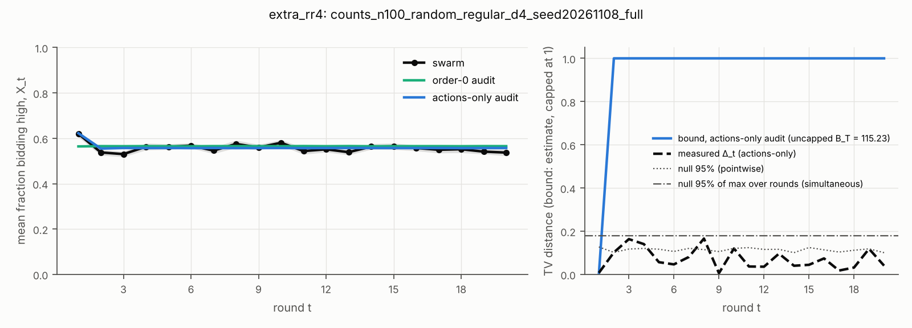
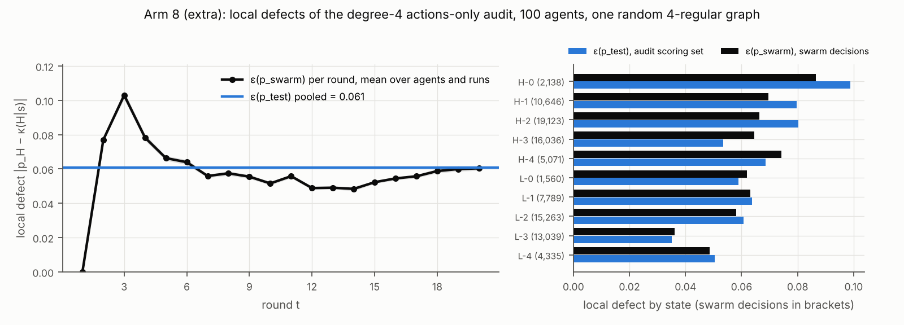

# Arm 8: 100 agents on one random 4-regular graph, counts only

**Status: complete.** 50 of 50 runs logged and analysed (7 Nov 2026, Modal workspace
`sensomichele`). This is **its own arm**: a scale and topology demonstration. It is **not** a
size-only contrast with the core's degree-2 cycles, because size and degree both change. It
uses the **counts-only** channel, so it says **nothing about signal effects** at n = 100.

## Design (frozen before any run)

| item | value |
|---|---|
| model | Llama-3.1-8B-Instruct, the core's revision, prompts and decoding |
| payoffs | (12, 10, 4, 0), the core pilot's frozen values (checked against `results/pilot/summary.json` before the runs) |
| agents, rounds, runs | n = 100, T = 20, **50 runs** (arm_id 8, base seed 20261107) |
| graph | **one** simple connected random 4-regular graph, seed 20261108 (pairing model with rejection). 200 edges, **measured diameter 6**, pair distances 1–6: 200 / 579 / 1,412 / 1,980 / 758 / 21; one triangle. Edge list: `graph_rr4_n100.json` |
| channel, history | counts (number of high bids among the 4 neighbours), full history |
| audit | degree-4 actions-only table κ(H \| s), fitted in this tree on p_test synthetic histories: 100 fit and 50 score histories per state, 1,502 model queries. Also an order-0 audit (one κ for every state after round 1) |
| serving | vLLM 0.32, batch invariance on, numerical floor 0 (X2). Drift panel at the start and end of each session: max difference **0** (`drift.json`) |

Ran as a 5-run benchmark, a cost projection (`arm8_benchmark.json`: $2.44 with the ×1.25
margin), then the remaining 45. Nothing was changed between the two sessions; both
sessions are in the manifest. No probability failed the p_valid check (0 of 100,000 decisions).

A state is written `own last bid – number of high neighbours`, so `H-3` means the agent
bid high last round and 3 of its 4 neighbours did too.

## What the swarm did

- **The mean fraction bidding high, X_t,** is 0.620 in round 1. In rounds 2–20 it
  stays between 0.530 and 0.580, with a mean of 0.554.
- **The late-round outcome** y (high bids in rounds 16–20, divided by 5n) has a per-run
  mean of 0.547. Its SD is 0.023 and its range is 0.502–0.616.
- **No run reached consensus** (every agent bidding the same) in any round.
- **About half of all edges disagree** (0.500, mean over rounds 2–20).
- **The fitted table explains the stationary level.**
  - After a high bid, P(H) is 0.37–0.61: it rises from 0.37 with no high neighbours
    to 0.61 with four.
  - After a low bid, it is 0.65–0.70, nearly whatever the neighbours did.
  - So agents tend to switch their own bid, and the swarm settles near 0.55 rather than
    locking in.

## Forecasts of y

| predictor | CRPS (95% CI) | E_swarm F − E_model F (95% CI) |
|---|---|---|
| order-0 audit | 0.0170 [0.0140, 0.0204] | −0.0178 [−0.0240, −0.0112] |
| actions-only audit (d = 4) | **0.0142** [0.0113, 0.0173] | −0.0096 [−0.0157, −0.0034] |

- **Order-0 minus actions-only, paired per run:** +0.0028 [0.0016, 0.0039]. The
  actions-only forecast is better in 39 of 50 runs.
- **Bias:** the actions-only chain's late-round mean is 0.557 against the swarm's 0.547.
  It overstates high bidding by about one percentage point, and the interval excludes 0.

**Swarm-fitted baseline, scored on runs 26–50 only.** This baseline is fitted on runs 1–25,
so it uses swarm data and is not an audit.

| predictor | CRPS (95% CI) | E_swarm F − E_model F (95% CI) |
|---|---|---|
| order-0 audit | 0.0152 [0.0115, 0.0192] | −0.0108 [−0.0193, −0.0020] |
| actions-only audit | 0.0136 [0.0100, 0.0177] | −0.0026 [−0.0117, 0.0069] |
| fitted from swarm | 0.0133 [0.0095, 0.0181] | +0.0009 [−0.0084, 0.0103] |

- **The audit almost matches the swarm-fitted baseline.** On the same held-out runs, the
  actions-only audit's CRPS is within 0.0003 of a table fitted to the swarm itself. That is
  far smaller than either interval.
- **These absolute CRPS values are small partly because y varies little** from run to run
  (SD 0.023).

## Distance between the swarm and each prediction (Δ_t, binned TV over runs)

- **Actions-only:** Δ_t peaks at 0.166 in round 8. That is below the 95% null for the
  maximum over all rounds (0.180).
  - It is above the pointwise 95% null in 3 rounds (3, 4 and 8). About one such round in
    20 would be expected by chance.
- **Order-0:** Δ_t peaks at 0.446 in round 1, where it uses its single κ instead of
  the START probability. That is above the 95% null for the maximum (0.186), and Δ_t is
  above the pointwise null in 7 rounds.
- **This TV is an empirical estimate** over 50 runs. The null references are matched and
  simulated, as in the core.

## Local defects and the bound

| quantity | value |
|---|---|
| ε(p_test), pooled over the audit's scoring set | 0.061 |
| ε(p_swarm), over all 100,000 swarm decisions | 0.058 |
| defect shift ε(p_swarm) − ε(p_test), pooled | −0.003 (state frequencies −0.001, within states −0.002) |
| shift, rounds 2–7 / 8–13 / 14–20 | +0.010 / −0.011 / −0.008 |
| bound B_t, uncapped | B_2 = 7.7, B_20 = 115.2; capped at 1 from **round 2** |

- **Per-round defects:** the swarm's defect peaks at 0.103 in round 3, when histories
  are short and unlike most p_test histories. It falls to about 0.05 in rounds 12–14 and
  returns to 0.060 by round 20.
- **By state:** the swarm's defects follow the audit's scoring defects closely.
  - The largest are in high-bid states with few high neighbours: H-0 is 0.086 in the
    swarm and 0.099 in the audit.
  - The smallest is L-3: 0.036 and 0.035.
- **The bound is vacuous at this size.** It sums the local defect over 100 agents, so it
  passes 1 after the first transition. Meanwhile the measured Δ_t stays below 0.17. The
  bound here is a logged-defect estimate, not a certified bound.

## Network statistics (rounds 2–20 means)

Agreement between pairs of agents by graph distance:

| pairs at distance | swarm | actions-only audit | order-0 audit |
|---|---|---|---|
| 1 (adjacent) | 0.500 | 0.499 | 0.508 |
| 2 (share a neighbour) | 0.507 | 0.507 | 0.508 |
| ≥ 3 | 0.506 | 0.506 | 0.509 |

- **Adjacent pairs agree slightly less** than more distant pairs.
- **The actions-only chain reproduces this** to within 0.001. The order-0 audit has no
  neighbour dependence, so it cannot.

## Limitations

- **One graph realization.** The variation across random 4-regular graphs was not measured.
- **Counts only.** No signal or cheap-talk channel ran at n = 100, so nothing here bears
  on signal effects.
- **Not a size contrast.** The core uses cycles (degree 2) at n = 10 and 20; this arm
  changes both n and degree.
- **The intervals are conditional on the fitted tables.** They resample whole runs and
  leave out audit-estimation uncertainty.
- **Cross-account serving.** It was checked on the 136-prompt drift panel only (X3: every
  prompt matched, max difference 0). That supports, but does not prove, an identical
  kernel on both accounts.

## Files

- **Runs:** `runs/extra_rr4/counts_n100_random_regular_d4_seed20261108_full/`. This
  holds the 50 logs, `provenance.json` and `drift.json`. The sessions are in
  `runs/extra_rr4/manifest.json`.
- **Audit table:** `audit/llama-3.1-8b/counts_d4_actions.json`
- **Analysis:** `analysis/extra_rr4/counts_n100_random_regular_d4_seed20261108_full.json`
- **Numbers quoted here:** `arm8_numbers.json`, from `scripts/extra_arm8_report.py`, which
  reads logs only.
- **Figures:** `figures/fig1_extra_rr4_…png` (X_t and the bound) and `figures/arm8_defects.png`.
- **Graph:** `graph_rr4_n100.json`. **Benchmark and projection:** `arm8_benchmark.json`.
