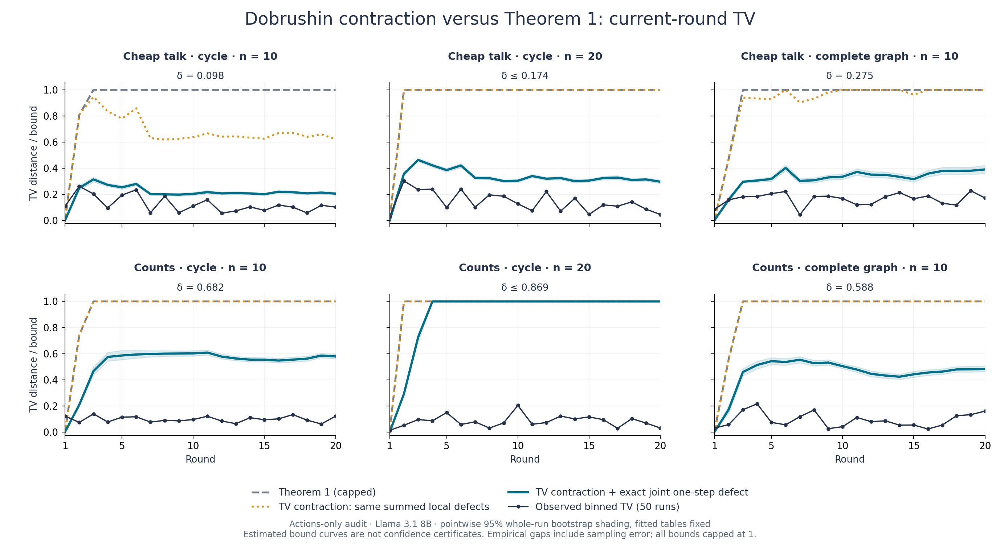
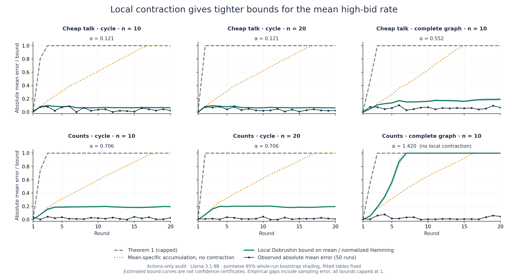

# Dobrushin contraction in the swarm audit experiments

8 November 2026. Exploratory reanalysis of existing data; no new model calls or fitting.

Dobrushin contraction substantially improves the current-round bounds in the primary cheap-talk experiment. It does **not** replace Theorem 1's guarantee for the whole trajectory. For the primary condition, the round-20 estimate falls from the capped Theorem 1 value of 1 to 0.623 using contraction with the **same local defects**, and to 0.205 when the one-step defect is also evaluated jointly. The corresponding local bound on the absolute mean high-bid error is 0.064.

The correct presentation is to retain Theorem 1 for trajectories and add a marginal contraction result for individual rounds, with a separate local result for mean statistics.



## 1. What is being bounded

Let $A_t\in\{0,1\}^n$ be the high-bid indicator profile, $\mu_t$ its true swarm law, and $\nu_t$ the actions-only audit predictor's law. The audit predictor has the homogeneous order-1 transition

$$P(x,y)=\prod_i\operatorname{Bern}\!\left(\kappa_i(H\mid s_i(x))\right)(y_i),\qquad t\ge2.$$

The round-1 START distribution is handled separately. The true full-history swarm need not be Markov on $A_t$. In cheap talk, the true conditioning history includes the hidden signals as well as actions.

The plotted TV bounds control $d_{\rm TV}(\mu_t,\nu_t)$. By data processing, they also control population TV for the binned high-bid fraction $X_t=n^{-1}\sum_i A_{i,t}$ used in the existing analysis.

**They do not control the full action-trajectory TV, the distribution of the five-round endpoint $F$, or the distribution of consensus time.** Those observables retain history. For the expected value of $F$, the separate mean bound below can be averaged over rounds 16–20.

## 2. Marginal TV contraction result and proof

The global Dobrushin coefficient of the audit transition is

$$\delta(P)=\sup_{x,x'}d_{\rm TV}(P(x,\cdot),P(x',\cdot)).$$

Let $\mathcal H_{t-1}$ denote the true global history and write $p_{i,t}=K_i(H\mid h_i^t)$ and $q_{i,t}=\kappa_i(H\mid s_i(A_{t-1}))$. Define the joint conditional one-step defect

$$\eta_t=\mathbb E_{\rm swarm}\left[d_{\rm TV}\left(\bigotimes_i\operatorname{Bern}(p_{i,t}),\bigotimes_i\operatorname{Bern}(q_{i,t})\right)\right].$$

Conditional independent agent sampling is the same assumption used by the repository. Let $D_1=d_{\rm TV}(\mu_1,\nu_1)$; then

$$d_{\rm TV}(\mu_t,\nu_t)\le D_t:=\delta(P)D_{t-1}+\eta_t
=\delta(P)^{t-1}D_1+\sum_{s=2}^t\delta(P)^{t-s}\eta_s.$$

**Proof.** Integrating $P(A_{t-1},\cdot)$ against the true history gives $\mu_{t-1}P$. Convexity of TV yields $d_{\rm TV}(\mu_t,\mu_{t-1}P)\le\eta_t$. The triangle inequality and Dobrushin contraction give

$$d_{\rm TV}(\mu_t,\nu_{t-1}P)\le\eta_t+\delta(P)d_{\rm TV}(\mu_{t-1},\nu_{t-1}).$$

Iterate. The START mismatch is zero in these experiments, apart from machine precision.

For comparison with Theorem 1, define $e_t=\sum_i\mathbb E|p_{i,t}-q_{i,t}|$. Product coupling gives $\eta_t\le e_t$. Replacing $\eta_t$ by $e_t$ gives the orange curve: **the same errors as Theorem 1, with geometric discounting**. The teal curve uses exact product-law TV for $\eta_t$, which avoids Theorem 1's additional union bound across agents. Thus the figure separates two improvements:

1. contraction discounts earlier errors;
2. joint evaluation tightens each round's error injection.

Setting $\delta=1$ and replacing $\eta_t$ by $e_t$ recovers the accumulated marginal bound implied by Theorem 1. If $\eta_t\le\bar\eta$ and $\delta<1$, the bound approaches $\bar\eta/(1-\delta)$ instead of growing linearly in time; it is useful only if that scale is below 1.

Contraction cannot discount errors in retained past coordinates of an entire trajectory. The lifted transition that keeps the whole past has coefficient 1 across distinct pasts. For a terminal window, errors before the window can be discounted until its start, but errors within that retained window must still accumulate.

## 3. A local Dobrushin result for the mean

For binary actions, define the influence matrix

$$C_{ij}=\sup_{x,x':\,x_\ell=x'_\ell\;(\ell\ne j)}\left|\kappa_i(H\mid s_i(x))-\kappa_i(H\mid s_i(x'))\right|.$$

Under a stepwise coupling of the true swarm and audit predictor, let $u_{i,t}$ bound their probability of disagreement at agent $i$. With $\epsilon_{i,t}=\mathbb E|p_{i,t}-q_{i,t}|$,

$$u_t\le\epsilon_t+C u_{t-1},\qquad u_1=\epsilon_1.$$

To see this, insert the audit probability at the true state between the true probability and the audit probability at the coupled predictor state. The first difference is the local defect, and telescoping single-coordinate changes bounds the second by $C$ times the prior disagreement probabilities. Shared independent uniforms implement the Bernoulli couplings while preserving the true and predictor marginal laws. True signals can subsequently be drawn conditional on the true actions.

For the homogeneous regular undirected graphs here, set

$$c_{\rm self}=\max_k|K[H,k]-K[L,k]|,\quad c_{\rm nb}=\max_{a,k}|K[a,k+1]-K[a,k]|,\quad \alpha=c_{\rm self}+d c_{\rm nb}.$$

All row and column sums of $C$ equal $\alpha$. Consequently

$$|\mathbb E_{\rm swarm}X_t-\mathbb E_{\rm audit}X_t|\le M_t,\qquad
M_t=\bar\epsilon_t+\alpha M_{t-1},\qquad
\bar\epsilon_t=\frac1n\sum_i\epsilon_{i,t}.$$

This also bounds a normalized-Hamming Wasserstein discrepancy, and hence expectations of observables that are 1-Lipschitz in normalized Hamming distance. It **does not** give a TV bound for the law of $X_t$. If $\alpha<1$ and $\bar\epsilon_t\le\bar\epsilon$, its limiting scale is $\bar\epsilon/(1-\alpha)$, without the explicit factor of $n$ in Theorem 1. When $\alpha\ge1$, this sufficient local contraction test fails; that does not prove that the global chain fails to mix.



## 4. Numerical results

All values below are round-20 plug-in bound estimates, capped at 1. Every full-history condition has 50 runs and 20 rounds. The last column bounds absolute error in the **mean** high-bid fraction; the other bound columns concern **TV** and must not be compared as if they measured the same discrepancy.

| Condition | Global $\delta$ | Local $\alpha$ | Theorem 1 | TV, same local defects | TV, joint defect | Mean, local |
|---|---:|---:|---:|---:|---:|---:|
| Cheap talk, cycle, n=10 | 0.098 | 0.121 | 1.000 | 0.623 | 0.205 | 0.064 |
| Cheap talk, cycle, n=20 | ≤ 0.174 | 0.121 | 1.000 | 1.000 | 0.296 | 0.061 |
| Cheap talk, complete, n=10 | 0.275 | 0.552 | 1.000 | 1.000 | 0.391 | 0.192 |
| Counts, cycle, n=10 | 0.682 | 0.706 | 1.000 | 1.000 | 0.579 | 0.195 |
| Counts, cycle, n=20 | ≤ 0.869 | 0.706 | 1.000 | 1.000 | 1.000 | 0.196 |
| Counts, complete, n=10 | 0.588 | 1.420 | 1.000 | 1.000 | 0.482 | 1.000 |

For primary cheap talk, cycle n=10, the uncapped Theorem 1 estimate is 11.979 and becomes vacuous at round 3. The contraction estimate using joint defects is **0.205 [0.195, 0.217]** at round 20; it remains below 0.315 throughout rounds 2–20. Its current-round mean bound is **0.064**. Averaging the mean bounds over the last five rounds bounds the error in the expected endpoint $F$ by approximately **0.067**.

For cheap talk, cycle n=20, the joint-TV estimate is **0.296 [0.283, 0.310]**, whereas using the original summed local defects still yields a capped bound of 1. This demonstrates that the extra gain from joint evaluation matters; contraction alone does not explain the teal curves.

For counts, cycle n=20, the uncapped joint-TV contraction estimate is **1.865**, so it remains vacuous after capping. Its local mean bound is still about 0.196. On the complete graph, counts has $\alpha=1.420$, so the local mean criterion fails, even though global TV contraction has $\delta=0.588$. These are different metrics and different sufficient criteria.

Calibration checks are saved in the data but omitted from the six-panel figures. Cheap talk n=4 has estimated round-20 joint-TV bound 0.162, versus capped Theorem 1 value 1. Counts n=4 has zero logged defect and both bounds are zero. The empirical gap from finite runs can be positive even in that exact-transfer control.

## 5. Merits and limitations compared with Theorem 1

| Aspect | Theorem 1 | Dobrushin approach |
|---|---|---|
| Observable | Whole trajectory and all its statistics | Current state and its functions; local version bounds Lipschitz expectations |
| Time dependence | Accumulates all errors | Discounts errors by a measured or bounded contraction factor |
| Swarm size | Sums across agents | Global TV can still worsen with size; normalized local mean bound avoids an explicit factor of n |
| Assumptions | Conditional independent agents and defined audit tables | Same, plus a useful contraction estimate on a sufficient predictor state |
| Computation | Cheap sum of logged local errors | Global coefficients and exact joint defects can be exponential; local influences are cheap |
| Distribution shift | Uses defects on swarm histories | Still uses defects on swarm histories; does not justify substituting isolated-test defects |
| Weak mixing | Remains valid but often vacuous | Can also be vacuous; local criterion may fail even when global mixing exists |

**Recommendation.** Use the global TV contraction result as the main bound for per-round forecast plots, showing the orange same-defect curve to make the comparison with Theorem 1 fair. Use the local result for mean high-bid rates and expected endpoint values. Retain Theorem 1 for trajectory-level claims. Describe the result as improved retrospective error propagation, not as a certificate that isolated audits alone suffice.

The contraction factor belongs to the **fitted audit predictor**. A rapidly mixing predictor can still be wrong: the defects quantify its mismatch to the real swarm. This analysis does not establish that the real full-history swarm itself mixes at that rate, nor does it change the existing primary CRPS conclusion.

## 6. Computation, uncertainty and verification

- For n=4 and n=10, the full actions-only transition matrix was constructed and $\delta(P)$ was computed by checking **all** transition-row pairs (16 and 1,024 profiles respectively).
- For n=20, the reported number is an **upper bound**, not the exact global coefficient. If all per-agent audit probabilities lie in $[\ell,h]$, maximize TV over all product Bernoulli rows with parameters in that interval. TV is convex separately in each parameter, so the maximum occurs at interval endpoints. Identical coordinates can be replaced by differing endpoints without reducing TV. Permutation symmetry then leaves n+1 orientations. Each orientation is evaluated through two groups of binomial counts. This bound enlarges the feasible set of transition rows and is therefore conservative.
- For every logged run and round, $\eta_t$ was evaluated by enumerating the two binary product laws. This is exact for the logged conditional probabilities up to floating-point arithmetic, including at n=20. No Monte Carlo estimate of the one-step joint TV was used.
- Bound expectations are estimated from live-run histories, not known exactly. Shading uses 2,000 **whole-run** bootstrap resamples, pointwise 95%, conditional on the frozen fitted audit tables and coefficients. It excludes audit fitting uncertainty and is not a simultaneous confidence band or a finite-sample certificate. No strict inference should be made from an empirical dot crossing a bound estimate.
- The observed binned TV and its audit reference are retained from the published analysis (20,000 reference simulations). The observed mean uses exact predictor propagation for n≤10 and the published 20,000-run predictor mean at n=20. All empirical swarm quantities have sampling error.
- Mathematical implementation checks verify product-law normalization, zero and deterministic TV cases, the discount recursion at rates 0 and 1, and exhaustive agreement of the parameter-box maximum for n=1…4.
- A further **population-level check** propagates the exact 1,296-state hidden-signal calibration chain against the 16-state actions-only audit. Both TV and mean inequalities hold in every one of the 20 rounds, with exact population expectations rather than sampled live-run defects. At round 20 the actual profile TV is 0.00424 versus bound 0.15835, and actual mean error is 0.000379 versus bound 0.07577. See `verification.json`.
- All calculations use float64; the coefficients are numerical evaluations, without formal interval-arithmetic certification. No GPU use or new data collection was required.

## 7. Sources and reproduction

Frozen repository: [AbdulMusthakin/swarm-audit](https://github.com/AbdulMusthakin/swarm-audit), commit `4fbe5519344294ed08094aad616446a39dde8a61`.

- [Theorem 1 and defect definition](https://github.com/AbdulMusthakin/swarm-audit/blob/4fbe5519344294ed08094aad616446a39dde8a61/setup-paper/sections/3-results.tex)
- [Swarm and audit assumptions](https://github.com/AbdulMusthakin/swarm-audit/blob/4fbe5519344294ed08094aad616446a39dde8a61/setup-paper/sections/2-setup.tex)
- [Actions-only transition implementation](https://github.com/AbdulMusthakin/swarm-audit/blob/4fbe5519344294ed08094aad616446a39dde8a61/swarm_audit/prediction.py)
- [Existing Theorem 1 estimator](https://github.com/AbdulMusthakin/swarm-audit/blob/4fbe5519344294ed08094aad616446a39dde8a61/swarm_audit/stats.py)
- [Primary experiment analysis](https://github.com/AbdulMusthakin/swarm-audit/blob/4fbe5519344294ed08094aad616446a39dde8a61/results/analysis/core_cheap_talk/cheap_talk_n10_cycle_full.json)
- [Published follow-up and limitations](https://github.com/AbdulMusthakin/swarm-audit/blob/4fbe5519344294ed08094aad616446a39dde8a61/results/followup/core/summary.md)

`dobrushin_results.json` records each input path, its SHA-256, condition metadata, coefficients, curves, bootstrap bands and reference-law provenance. `dobrushin_curves.csv` provides uncapped values for all eight conditions. The PNG and PDF figures cap theoretical bounds at 1 for readability.

From the repository root, run (the saved analysis uses the frozen input commit above):

```bash
python scripts/analyse_dobrushin.py --repo . --out results/followup/dobrushin
python scripts/verify_dobrushin.py . results/followup/dobrushin/verification.json
```

Dependencies: Python 3, NumPy, SciPy and Matplotlib. The analysis scripts read repository data only and do not change the original experiments.
